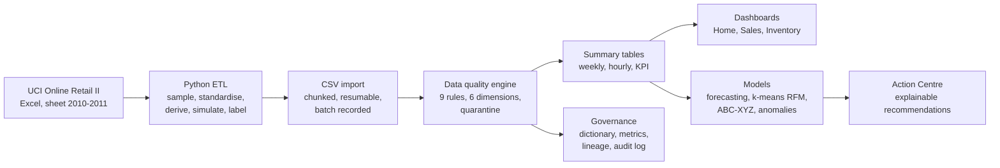

# ShelfSignal

**Retail intelligence you can audit, not just admire.**

ShelfSignal is an end-to-end retail analytics app built on a *Trust Layer*: every number shows where it came from, which data quality rules it passed, and whether any part of it is simulated. It turns 104,976 real retail transactions into dashboards, forecasts, customer segments and a prioritised action list, with governance and access control built in.

- **Live demo (read-only, no sign-up):** https://shelf-signal-trust.base44.app
- **2-minute video walkthrough:** `docs/ShelfSignal_demo.mp4`
- **Author:** Jannathul Firdouz, BI & Data Analyst, Auckland (Master of Analytics, AUT)

> Portfolio project. Sales and customer data are real (UCI Online Retail II). Product cost, stock, supplier and customer email fields are simulated, and the app labels them as simulated wherever they appear.

---

## The problem

Small and mid-sized retailers already have data: sales exports, stock spreadsheets, customer lists. Three things usually go wrong:

1. **Nobody checks the data before using it.** Duplicates, cancelled orders, fee codes and missing customer IDs flow straight into reports.
2. **Dashboards show what happened, not what to do.** A falling stock chart does not say which product to reorder first, or how many.
3. **Nobody can trace a number back to its source.** When two reports disagree, there is no way to settle it.

ShelfSignal answers each of these: check first, then analyse, then recommend, and keep every step traceable.

## What it does

| Business question | How ShelfSignal answers it |
| --- | --- |
| Can I trust this number? | A Trust Score and the count of excluded rows on every analytics page |
| What should I do this week? | An Action Centre of reorder, markdown, investigate and re-engage recommendations, each with a plain-English reason |
| What will we sell next? | Weekly demand forecasts that show their backtest error, not just a line |
| Who are our best customers, and who is slipping away? | RFM segments (Champions, Loyal, At risk, Lost) with revenue at risk |
| Where did this figure come from? | KPI lineage from source file, through quality rules, to the page that shows it |
| Who can see what? | Role-based access; customer emails and the audit log are owner-only |

## Architecture



**Stack:** Python (pandas) for ETL; Base44 with TanStack Start (React 19, server functions) for the app; Recharts for charts; models written as plain JavaScript server functions.

## Data

| Item | Value |
| --- | --- |
| Source | [UCI Online Retail II](https://archive.ics.uci.edu/dataset/502/online+retail+ii), sheet "Year 2010-2011" |
| Period | 1 December 2010 to 9 December 2011 |
| Sales rows imported | 104,976 (top 120 products by revenue, plus 300 fee and adjustment rows kept on purpose) |
| Customers | 4,004 |
| Stores | 3 regional stores mapped from country: United Kingdom, Europe, Rest of World |
| Categories | 9, derived from product descriptions by keyword rules |

Every field is labelled **Real**, **Derived** or **Simulated** in the in-app data dictionary (177 fields). Unit cost (55 to 65% of price), weekly stock snapshots, suppliers, lead times and customer emails are simulated.

The ETL script (`python/shelfsignal_prepare_data.py`) does structural preparation only. It deliberately does **not** clean real quality problems, so the app's Trust Layer has real cases to catch.

## Data quality engine

Rules run on every import. Critical failures are quarantined and excluded from every KPI, model and recommendation; warnings are flagged but kept.

| Rule | Dimension | Severity | Rows failed |
| --- | --- | --- | --- |
| No duplicate sales rows | Uniqueness | Critical | 846 |
| SKU exists in Product (excludes POST, M, BANK CHARGES and similar) | Consistency | Critical | 300 |
| Unit price above zero | Validity | Critical | 181 |
| Quantity positive unless a return | Validity | Critical | 54 |
| Date not in the future | Timeliness | Critical | 0 |
| Return invoices flagged | Validity | Warning | 2,158 |
| Customer reference present | Completeness | Warning | 21,174 |
| Price within 50% of list price | Accuracy | Warning | 19,892 |
| Quantity not an outlier (above 10,000) | Accuracy | Warning | 4 |

**Trust Score: 94.6%** (weighted pass rate: completeness 25, validity 25, uniqueness 20, consistency 15, timeliness 15; accuracy reported separately). **1,324 rows quarantined.**

Every count above was reconciled against an independent Python calculation of the same rules.

## Models

| Model | Method | Validation |
| --- | --- | --- |
| Demand forecasting | Naive, 4-week moving average, simple exponential smoothing, Holt's linear trend and damped Holt, per store and category plus each store's top 20 SKUs | Backtest on the last 8 complete weeks; lowest WAPE wins, and within 1 percentage point the smallest absolute bias wins. 80% band widens with the square root of weeks ahead. Series with fewer than 16 weeks are skipped and the reason is shown |
| Customer segmentation | k-means (k = 4, fixed seed, 10 initialisations) on log-transformed, winsorised, standardised RFM | Cross-checked against rule-based RFM quintile scores |
| ABC-XYZ classification | ABC by cumulative revenue share (80/15/5), XYZ by coefficient of variation of weekly units | 345 store and SKU positions classified |
| Anomaly detection | Rolling 28-trading-day z-score on daily revenue per store and category | Flags only when \|z\| > 3 **and** the deviation is at least £500; November and December labelled "Peak season" |
| Reorder points | Forecast demand over lead time plus safety stock (1.65 × σ × √(lead time / 7)) | Peak-season guard switches to the last 8 weeks of actuals |

### Selected results

- **Forecast accuracy:** UK Kitchen & Dining, Holt wins with **19.7% WAPE**; Europe's lumpier demand gives about 36% for every model. 63 of 87 candidate series were forecast; 24 were skipped for too little history.
- **Segments:** **16% of customers (Champions) bring in 74% of revenue.** £86,000 of revenue sits with At risk customers. k-means and rule-based RFM agree on **62.3%** of customers, and most disagreements are between neighbouring segments.
- **Recommendations:** about 146 actions, reorders prioritised to ABC class A and B, with outlier-driven products excluded and listed with the reason.

## Governance

- **Data dictionary:** 177 fields with definition, owner, source, Real / Derived / Simulated type, and sensitivity (Public, Internal, Confidential, PII).
- **Metric definitions:** one agreed formula per KPI, shown as tooltips on every KPI card.
- **KPI lineage:** for net revenue, `sales_transactions.csv` (104,976 rows) to quality rules (1,324 quarantined, 103,652 used) to `SalesWeeklySummary` to formula to pages.
- **Audit log:** imports, quality runs, rule decisions (old to new status), dictionary edits (before and after values), role changes, model runs and recommendation decisions. Owner-only and append-only.
- **Privacy:** customer email retention setting with preview, designed with the NZ Privacy Act 2020 principles in mind.

## Security and access

| Role | Access |
| --- | --- |
| Owner | Everything, including customer emails, audit log, privacy and admin |
| Analyst | All stores; runs imports, quality checks and models; edits definitions |
| Store manager | Own store only in every analytics view; decides recommendations for that store |
| Viewer | Read-only, all stores, emails masked |
| Public demo visitor | Read-only analytics; no emails, audit log, privacy, admin, imports or model runs |

Tested as an anonymous visitor by calling the API directly, not just by checking which buttons are hidden: customer records come back **without** the email field, the audit log and user profiles return nothing, and a direct update attempt is refused with **403 Permission denied**.

**Design trade-off, stated plainly:** to offer a public demo, read access to the sales and inventory tables is open, and store-level scoping for store managers is enforced in the application layer (`src/lib/store-scope.server.js`) rather than in table rules. Customer emails and the audit log remain protected at the data level. In a production deployment I would remove the public demo and restore store-level row rules on the tables.

## What testing found (and how it was fixed)

| Finding | Fix |
| --- | --- |
| Profile showed 0% missing customer IDs, but about 20% were missing: blanks were stored as empty text, not nulls | Treat empty and whitespace values as missing, so the Trust Score is not overstated |
| A dashboard server function bypassed store-level rules, so a Europe store manager saw all 500 test rows instead of 27 | One shared store-scope filter used by every backend query |
| The platform limits writes to 100,000 records a day | Quality results stored as one summary per rule instead of one record per row; reruns only write rows that change |
| One cancelled 80,995-unit order inflated the return rate from 2.42% to 8.87% | Return rate excludes outlier rows by default, with a toggle |
| The first segmentation labelled every customer "Champions" | Blank customer IDs had been grouped into one giant customer; fixed exclusion, winsorising and cluster labelling, then validated against RFM quintiles |
| Holt's model extrapolated the pre-Christmas ramp into January | Added damped Holt, a rising-trend flag and a peak-season guard on reorders |
| The anomaly detector flagged the whole Christmas ramp | Added a £500 materiality threshold and a "Peak season" label |
| The top recommendation was a £208,965 markdown driven by the cancelled outlier order | Products whose sales are dominated by outlier rows are excluded and listed with the reason |
| Monthly revenue showed a false +240% jump | Months were derived from week start dates; rebuilt from transaction dates |
| The public Forecasting page showed the owner's email | User identities are shown as roles to visitors |

## Known limitations

- One year of data, so yearly seasonality (the Christmas peak) cannot be learned by the in-app models.
- Stock, cost and supplier data are simulated, so reorder and markdown values illustrate the method rather than a real business.
- The dataset ends on 9 December 2011, so recommendation outcomes cannot be measured.
- Store-level scoping is enforced in the application layer while the public demo is enabled (see Security).

## Repository structure

```
base44/entities/      26 table definitions with field and row-level access rules
src/lib/              Server logic
  store-scope.server.js     Role and store access filter used by every query
  dq-rules.server.js        Quality rules, evaluator and Trust Score
  ml.server.js              Forecasting, k-means, RFM, ABC-XYZ, anomalies
  recommendations-fns.js    Action Centre generator
  governance-fns.js         Dictionary, metrics, lineage, audit
  summary-fns.js            Precomputed summaries for fast pages
src/routes/           Pages (Home, Sales, Inventory, Customers, Forecasting,
                      Action Centre, Data quality, Governance, Models, Admin, Privacy)
python/               ETL script for the UCI dataset
docs/                 Demo video and screenshots
```

## Running locally

The app runs on Base44 (TanStack Start, React 19), server-rendered and hosted by Base44. Data access, authentication and server functions depend on the Base44 backend, so a local run needs a linked Base44 app.

```bash
npm ci
base44 login   # one-time per machine
base44 link    # one-time per clone
base44 dev     # local backend and app together
```

Build and publish:

```bash
npm run build
base44 deploy
```

To regenerate the CSVs from the source data:

```bash
pip install pandas numpy openpyxl
python python/shelfsignal_prepare_data.py
```

## Data source and licence

Chen, D. (2012). *Online Retail II* [Dataset]. UCI Machine Learning Repository. https://doi.org/10.24432/C5CG6D (CC BY 4.0).
